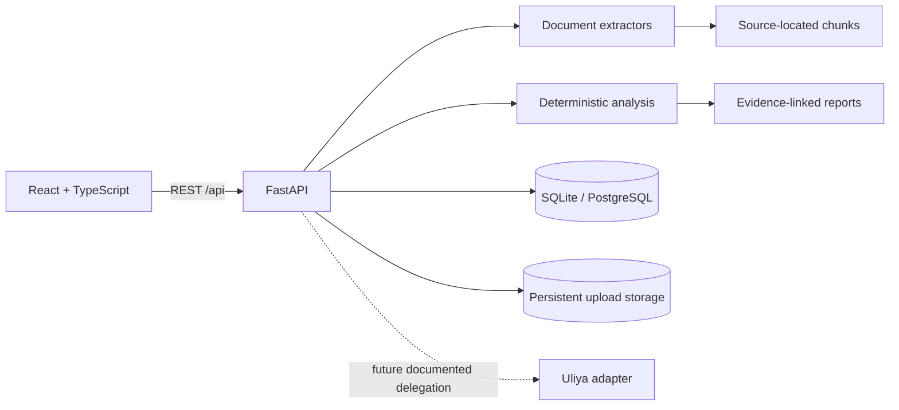

# Aether-NAS

**The Knowledge Continuity Engine** — “Your files preserve information. Aether preserves why it matters.”

Aether-NAS turns project documents into a source-linked working brief. The central workflow, Project Resurrection, extracts statements from uploaded documents, classifies decision, requirement, and question candidates, and flags possible conflicts for human review. The local demo uses deterministic rules and reads only supplied document text. It does not claim to determine the current real-world project state.

> Aqua-Nexus and its documents are synthetic demonstration material. No water treatment or safety claim should be inferred from them.

## Start locally

Requirements: Python 3.12+, Node.js 22+, npm.

```powershell
python -m venv .venv
.\.venv\Scripts\Activate.ps1
pip install -r backend/requirements.txt
uvicorn app.main:app --app-dir backend --reload --port 8000
```

In another terminal:

```powershell
npm install
npm --workspace frontend run dev
```

Open http://localhost:5173. Vite proxies `/api` to the local backend. Select **Explore the Aqua-Nexus demo** to create ten synthetic documents and run Project Resurrection. API documentation is at http://localhost:8000/docs.

## Docker

```sh
cp .env.example .env
docker compose up --build
```

Open http://localhost:8080. SQLite data and uploaded files persist in the `aether_data` volume. Set `AETHER_PORT` to change the host port. For production, terminate TLS at a trusted reverse proxy, restrict network access, configure `CORS_ORIGINS`, protect secrets, and set `DATABASE_URL` to PostgreSQL. Back up the database and uploaded files together.

## Features

- Project creation and user-controlled deletion.
- PDF, DOCX, PPTX, XLSX, TXT, Markdown, and CSV upload with extension and size checks, SHA-256 duplicate detection, safe basename handling, extraction status, and chunk locations.
- Persistent SQLite models for projects, documents, chunks, and generated reports; SQLAlchemy can use PostgreSQL through `DATABASE_URL`.
- Eight deterministic operating modes: `project-resurrection`, `decision-time-machine`, `knowledge-integrity`, `impact-analysis`, `knowledge-audit`, `gravitational-extract`, `topological-summarize`, and `matrix-organize`.
- Evidence explorer, source-ordered timeline, term-derived knowledge graph, conflict review, impact lookup, transparent debt indicator, and Markdown handover export.
- Responsive React interface and synthetic Aqua-Nexus demo.
- Honest offline Uliya adapter status and capability listing.

The deterministic analyzer is deliberately modest: it classifies textual patterns and compares some requirement candidates. Potential conflicts are not adjudicated, concepts are surface-form terms, and the timeline is source insertion order because document dates are not yet reliably parsed. No unsupported semantic certainty is presented.

## Architecture



## Environment

See [.env.example](.env.example). `AI_PROVIDER=mock` is the working offline default. `OPENAI_BASE_URL`, `OPENAI_MODEL`, and `OPENAI_API_KEY` configure the optional OpenAI-compatible JSON provider; `OLLAMA_BASE_URL` and `OLLAMA_MODEL` configure the optional Ollama JSON provider. Those model providers are adapter foundations and are not yet wired into the report extraction pipeline. The current report pipeline stays deterministic and source-derived regardless of those settings.

## Data and privacy

Uploaded documents are written to the configured data directory, and extracted text is stored in the database. They remain until the project is deleted or the deployment volume is removed. Deleting a project removes its database rows and uploaded files. Do not expose this unauthenticated demo service directly to the public internet. Source files are never modified. There is no automatic knowledge persistence outside the uploaded project and generated report store.

## Development and tests

```sh
python -m pytest backend/tests
npm --workspace frontend run build
npm --workspace frontend test
```

Backend endpoints are documented in OpenAPI at `/docs`; see [docs/API.md](docs/API.md). Migration and deployment notes are in [docs/ARCHITECTURE.md](docs/ARCHITECTURE.md) and [docs/SECURITY.md](docs/SECURITY.md). CI is configured in `.github/workflows/ci.yml`.

## Repository map

```text
backend/app/main.py          API, persistence, extraction, deterministic modes
backend/app/providers.py     Optional provider contracts
backend/tests/               API and source-evidence checks
frontend/src/App.tsx         Product interface and workflows
frontend/src/style.css       Responsive visual system
demo/aqua_nexus/             Synthetic demo collection
docs/                         Architecture, API, security, Uliya, roadmap
docker-compose.yml            Persistent local deployment
```

## Limits and next steps

- Production authentication, authorization, rate limiting, and CSRF controls are not implemented; keep the service on a trusted network.
- PostgreSQL is supported by SQLAlchemy URL configuration, but schema migrations and PostgreSQL-specific validation still need to be added.
- Model provider adapters exist, but LLM extraction is not wired into the core workflow; outputs currently use deterministic source parsing.
- The graph is a persisted-document-derived view; concept and relationship extraction is heuristic, not a semantic graph database.
- UGREEN NAS connectivity requires a documented SDK/API and a real NAS. No NAS operation is claimed to work here.
- Add authenticated multi-user access, Alembic migrations, richer document date/location parsing, review/approval persistence, PDF export, and end-to-end browser tests next.

## License

MIT. See [LICENSE](LICENSE).
